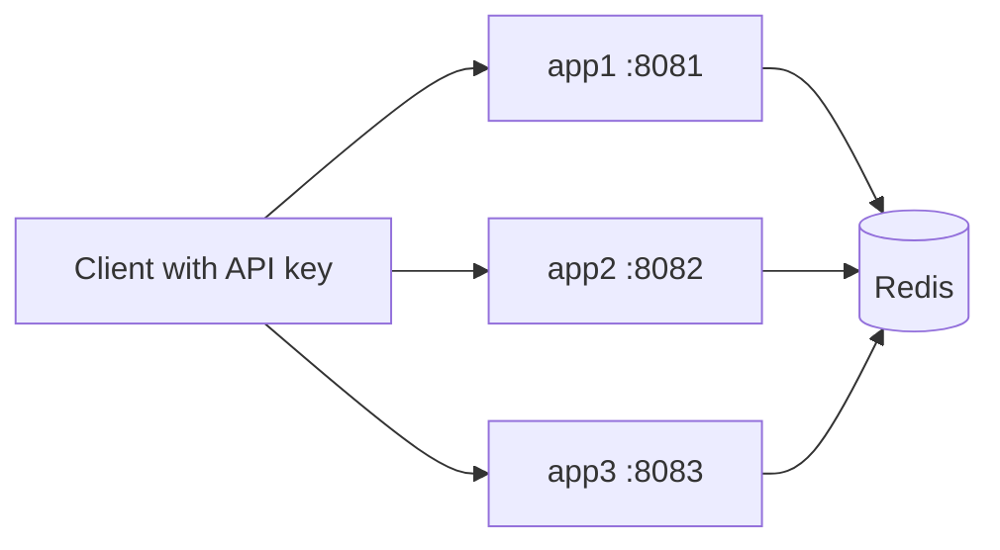
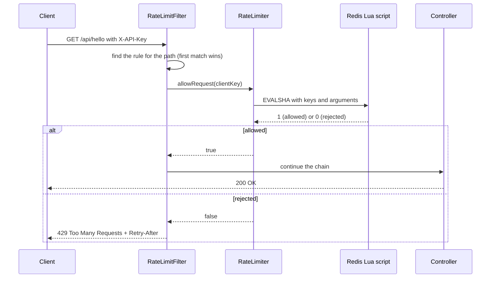
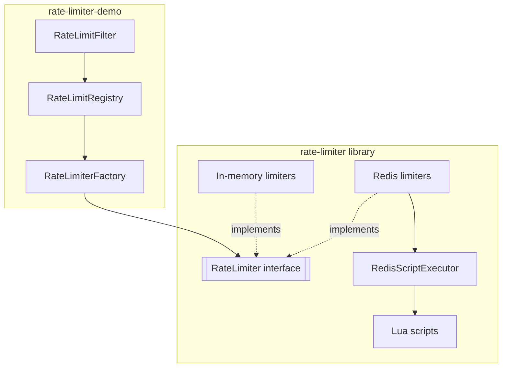

# Distributed Rate Limiter

A rate limiting library for Java, built from scratch. It implements **Token Bucket**, **Sliding Window** (Log and Counter variants) and **Leaky Bucket**, each in two forms:

- an **in-memory** version for a single JVM, and
- a **Redis-backed** version, so many service instances share one set of limits.

A Spring Boot service that uses the library, with a three-instance Docker Compose setup and a load test, lives in a separate repository: **[rate-limiter-demo](https://github.com/sakshijayasingh2002-lgtm/rate-limiter-demo)**.

## Highlights

- **Four algorithms written by hand.** No rate limiting libraries (no Guava, Bucket4j or Resilience4j), only Java and the Jedis Redis client.
- **Atomic in Redis.** Every decision (refill, check, spend) runs as one Lua script, so two instances can never both claim the last slot.
- **Proven across instances.** Integration tests use two separate connection pools (two "service instances") and race 50 threads against one key. A Docker Compose stack with three instances and a k6 load test confirm it end to end.
- **Testable by design.** Algorithms take a `TimeSource`, so tests control time instead of sleeping.
- **Explicit failure behavior.** When Redis is down, a limiter either lets requests through (fail open, the default) or rejects them (fail closed). Either way, a throttled warning is logged so the outage is not silent.

## Architecture

Three service instances, one shared Redis. All limit state lives in Redis, so it does not matter which instance a request lands on.



What happens to a single request in the demo service:



How the code is layered. Everything above the library only knows the `RateLimiter` interface, so algorithms and storage can be swapped through configuration:



## Algorithms

| Algorithm | State per client | Accuracy | Bursts | Good for |
|---|---|---|---|---|
| **Token Bucket** | 2 numbers (tokens, last refill time) | Refills continuously, so the long-run rate is exact | Allowed, up to the bucket capacity | General APIs that tolerate short bursts |
| **Leaky Bucket** | 2 numbers (level, last drain time) | Steady output rate | Not passed through: queued if there is room, otherwise rejected | Protecting a fragile downstream service, traffic shaping |
| **Sliding Window Log** | 1 entry per request inside the window | Exact | No boundary burst | Strict limits, expensive operations, low to moderate volume |
| **Sliding Window Counter** | 2 numbers (current and previous window counts) | Approximate: assumes requests are spread evenly inside a window | Small | High-volume traffic where O(1) memory matters |

### Token Bucket
Each client has a bucket holding up to `capacity` tokens. Tokens refill at a fixed rate and each request spends one. The refill is **lazy**: nothing runs in the background. When a request arrives, the code works out how many tokens accumulated since the last one, so idle clients cost nothing.

### Leaky Bucket
The bucket's "level" is the number of requests waiting in a queue. It drains at a constant rate, and a request that would overflow the bucket is rejected. Unlike Token Bucket it never lets a burst straight through. `acceptAndGetDelayMillis(key)` returns how long a request would wait in the queue (or `-1` if rejected), for callers that want real traffic shaping. `allowRequest(key)` is the plain allow/reject view of the same thing.

### Sliding Window Log
Keeps the timestamp of every request still inside the trailing window. A new request drops expired timestamps, counts the rest, and is allowed if there is room. Exact, but memory grows with traffic: one entry per request in the window, per client. In Redis this is a sorted set.

### Sliding Window Counter
Time is cut into fixed windows. The estimate for "requests in the last window" is `previousCount x overlapFraction + currentCount`, where the overlap shrinks as the current window progresses. Two integers per client, no matter how much traffic.

A plain **fixed window** counter (reset at each boundary) is deliberately not offered: a client can send a full limit at the end of one window and another full limit right after, which is double the limit in a tiny real time span. The previous-window blending in the Counter variant is what removes that.

### Which one to choose

- Want to allow short bursts but cap the average rate: **Token Bucket**.
- Need a smooth, steady flow into something fragile: **Leaky Bucket**.
- Need an exact count in a rolling window and traffic per client is modest: **Sliding Window Log**.
- Need rolling-window behavior at high volume with tiny memory: **Sliding Window Counter**.

## How the distributed part works

**The problem.** Imagine the obvious implementation: read the token count, check it, write the new count. With two service instances, both can read "1 token left" before either writes, and both let a request through. Java's `synchronized` cannot help, because it only works inside one JVM.

**The fix.** Each algorithm's logic runs inside Redis as a Lua script. Redis executes one script at a time from start to finish, so the read, the refill, the spend and the write happen as a single unit, with no locks.

Details that matter:

- **EVALSHA with a NOSCRIPT fallback.** The script is uploaded once and then called by its SHA1 fingerprint. If Redis forgets it (restart, `SCRIPT FLUSH`), the library reloads it and retries once.
- **Time is passed in.** Scripts receive `now` from the caller instead of using Redis's clock. This keeps the Redis limiters testable with a fake clock. The trade-off is that instances with skewed clocks disagree about "now". Using Redis `TIME` instead would give one authoritative clock, at the cost of testability.
- **Idle keys clean themselves up.** Every key gets an expiry, so clients that stop sending requests leave nothing behind.
- **Cluster-friendly keys.** Each script touches keys that can share a hash slot (the Sliding Window Counter wraps the client id in `{...}` so its two window keys land together). Not tested on an actual Redis Cluster.
- **Unique log entries.** In the Sliding Window Log, every request is stored as `timestamp:uuid`. A sorted set cannot hold two identical members, so using the timestamp alone would make two requests in the same millisecond count as one.
- **Fail open or closed.** The `failOpen` constructor flag decides what happens on a Redis error. Open (the default) keeps the service up; closed protects whatever is behind the limiter.

The Lua scripts are in [`src/main/resources/lua`](src/main/resources/lua).

## Usage

The contract is one method:

```java
public interface RateLimiter {
    boolean allowRequest(String key);   // key = whatever you rate-limit by: user id, API key, IP...
}
```

### In-memory (single JVM)

```java
// burst of 10, then 5 requests per second
RateLimiter limiter = new TokenBucketRateLimiter(10, 5.0, TimeSource.systemTimeSource());

if (limiter.allowRequest("user-42")) {
    // handle the request
} else {
    // reject with 429
}
```

### Redis-backed (many instances)

```java
JedisPool pool = new JedisPool("localhost", 6379);

// 100 requests per minute, shared by every instance that uses this Redis
RateLimiter limiter = new RedisSlidingWindowCounterRateLimiter(
        pool, 100, 60_000, TimeSource.systemTimeSource(), "rl:api:");
```

All eight classes follow the same pattern. The in-memory ones take `(settings..., TimeSource)`; the Redis ones take `(JedisPool, settings..., TimeSource, keyPrefix)` and optionally a final `failOpen` flag.

| Package | Classes |
|---|---|
| `...ratelimiter.core` | `RateLimiter`, `TimeSource` |
| `...ratelimiter.tokenbucket` | `TokenBucketRateLimiter` |
| `...ratelimiter.slidingwindow` | `SlidingWindowLogRateLimiter`, `SlidingWindowCounterRateLimiter` |
| `...ratelimiter.leakybucket` | `LeakyBucketRateLimiter` |
| `...ratelimiter.redis` | `RedisTokenBucketRateLimiter`, `RedisSlidingWindowLogRateLimiter`, `RedisSlidingWindowCounterRateLimiter`, `RedisLeakyBucketRateLimiter` |

## Getting started

**Requirements:** Java 17, Maven, and Docker (only for the Redis-backed tests and the demo).

The library is not published to Maven Central. Install it into your local Maven repository:

```
mvn install
```

Then depend on it:

```xml
<dependency>
    <groupId>com.sakshi</groupId>
    <artifactId>rate-limiter</artifactId>
    <version>0.1.0-SNAPSHOT</version>
</dependency>
```

## Testing

```
docker run -d --name redis-rl -p 6379:6379 redis:7
mvn test
```

There are **65 tests**:

- **In-memory algorithms.** Capacity, refill, window expiry, per-key isolation, invalid arguments, and a clock that jumps backwards.
- **Concurrency.** The same 50-thread race against one key, run on all four in-memory algorithms; exactly the limit gets through, never more.
- **Redis integration.** The same behaviors against a real Redis, plus the distributed cases: two separate connection pools sharing one bucket, a 50-thread race split across both, and fail-open versus fail-closed with Redis unreachable.

The Redis integration tests need Redis on `localhost:6379`. If Redis is not running they are **skipped**, not failed, so the project still builds on a machine without it.

All tests use a controllable `TimeSource`, so none of them sleep.

## Verified across instances

Beyond the unit and integration tests, the demo repository runs the real thing: three copies of the service in Docker, one shared Redis.

**Distributed proof.** A script sends 9 requests with the same API key to `/api/report` (limit: 2 per 15 seconds), rotating across the three instances. If each instance counted on its own, 6 would get through. With the limit in Redis, exactly 2 do:

```
Request 1 -> port 8081: 200 ALLOWED  (served by app1)
Request 2 -> port 8082: 200 ALLOWED  (served by app2)
Request 3 -> port 8083: 429 REJECTED
...
Request 9 -> port 8083: 429 REJECTED

Allowed: 2   Rejected: 7   (limit is 2 in total)
PASS - the limit held across all three instances.
```

**Load test.** A k6 script runs two scenarios against `/api/hello` (Token Bucket, burst 5, refill 1 per second):

| Scenario | What it checks | Expected allowed |
|---|---|---|
| One client at 50 req/s for 20 s, spread across 3 instances | The limit is shared. Burst 5 + 20 s of refill is about 25 out of about 1000. Per-instance counting would give about 75. | 20 to 30 |
| Ten clients at about 3 req/s each for 10 s | Limits are per client. Each client gets its own bucket (about 14 allowed each). | 120 to 170 |

The script is built to catch the exact bug this project exists to prevent: if each instance kept a private bucket, the single client would get about three times as many requests through (around 75), far outside the expected 20 to 30, and the run would end in FAIL. See the [demo repository](https://github.com/sakshijayasingh2002-lgtm/rate-limiter-demo) for how to run it.

## Design decisions and trade-offs

- **`RateLimiter` is a one-method interface.** Callers (a servlet filter, an interceptor) do not know which algorithm or storage is behind it, so swapping is a configuration change.
- **Lazy refill and drain instead of background threads.** No scheduler to manage, and idle clients cost nothing.
- **Per-key `synchronized` in memory.** Two threads on the same key serialize; different keys never contend.
- **Lua scripts instead of the alternatives.** `MULTI/EXEC` cannot branch on a value read in the middle ("only subtract if tokens >= 1"). `WATCH` with retry wastes round trips under contention. A distributed lock adds round trips and complexity for something one script solves.
- **Shared script executor.** Loading, EVALSHA, NOSCRIPT retry and fail-open handling live in one class, so a fix is made once.
- **Not trusting `X-Forwarded-For` (in the demo).** Any client can set that header, which would let them dodge a limit by changing it on every request. Behind a trusted proxy you would read it, but only from that proxy.

## Project structure

```
src/main/java/com/sakshi/ratelimiter/
    core/            RateLimiter, TimeSource
    tokenbucket/     TokenBucketRateLimiter
    slidingwindow/   SlidingWindowLogRateLimiter, SlidingWindowCounterRateLimiter
    leakybucket/     LeakyBucketRateLimiter
    redis/           Redis versions of all four, plus RedisScriptExecutor
src/main/resources/lua/
    token_bucket.lua, sliding_window_log.lua,
    sliding_window_counter.lua, leaky_bucket.lua
src/test/java/...    unit, concurrency and Redis integration tests
```

## Limitations and future work

- **Redis is a dependency of every decision.** Each request, allowed or not, makes one round trip to Redis. At very high traffic that becomes the bottleneck. Common remedies: a local pre-check or cache, batching, or spreading keys across several Redis nodes.
- **Single Redis.** There is no replication or failover handling beyond fail open / fail closed. Redis Cluster compatibility was designed for but not tested.
- **Clock skew.** Time comes from the caller. Using Redis `TIME` would remove skew between instances.
- **Sliding Window Counter is an approximation**, and the Log variant uses memory proportional to traffic.
- **No live configuration changes.** In the demo, limits are read at startup.
- **Not published to Maven Central.**
